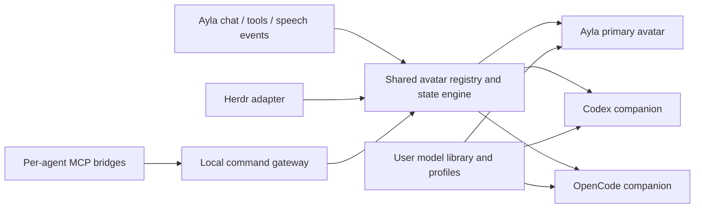

# Ayla integration assessment

Inspected 14 October 2026: `/run/media/mka/21a17bf0-b299-4fc4-b7ad-d1ae185d2d922/Code/Ayla`. Read-only inspection; Ayla was not modified, built, or launched.

**Integrating the agent companions into Ayla is feasible, and Live2D is the best initial format for that goal.** The earlier VRM recommendation favored generic Desktop Mate body movements. Ayla compatibility changes the priority: reusing its existing renderer, animation behavior, desktop host, and speech support avoids creating a parallel character system.

## Existing code we can build on

| Ayla source | Verified capability | Required extension |
| --- | --- | --- |
| `package.json` | Electron 41.10.7, Vite, Pixi 6, `pixi-live2d-display` | Reuse the existing toolchain; separately test desktop overlay behavior on this pinned version. |
| `electron/main.mjs` | Single-instance host, one Rust sidecar, trusted IPC, ordinary application window | Add optional avatar windows and companion lifecycle. The current window is not a transparent desktop pet. |
| `electron/preload.cjs` and `electron/ipc-policy.mjs` | Renderer/backend bridge and validation | Add narrowly scoped avatar APIs; do not give avatar windows the complete backend API. |
| `src/main.js` | Optional Live2D loading, Pixi scene, controllers, application event wiring | Extract avatar setup/update/disposal from the application UI entrypoint. |
| `src/live2d/mk6-profile.js` | Known Mk6 expressions, motion files, parameter IDs, model-specific corrections | Preserve as a dedicated profile; add generic manifest discovery and user mappings. |
| `src/live2d/mk6-controller.js` | Expression layering, slot conflicts, fades, motion playback | Generalize catalog input and keep model-specific behavior in profiles. |
| `src/live2d/animation-coordinator.js` | Owner leases, priority, expiry, process/chat/speech state | Separate general state policy from Mk6 and Ayla-specific service assumptions. |
| `src/live2d/mk6-procedural.js` | Model-specific procedural animation | Retain as an optional Mk6 implementation; do not apply its parameter IDs to arbitrary models. |
| `src/tts-player.js` | Queued WAV playback and mouth-level measurement | Reuse for Ayla speech; add routing/ownership before enabling other agents' speech. |
| `electron/static-server.mjs` | Local asset serving with model-root containment checks | Extend one configured model root into a validated model-ID library. |
| `electron/inspect-package.mjs` | Checks that Mk6 assets are absent from releases | Expand to all user avatar packages and caches. |
| `docs/evidence/desktop-performance-xwayland-2026-10-14.json` | Existing recorded XWayland diagnostics with an avatar | Useful baseline, not evidence that transparent multi-avatar windows already work. |

## Important gaps

The current loader is explicitly Mk6-oriented: it expects `Mk6.model3.json`, a fixed expression catalog, known motion paths, and known parameter IDs. Arbitrary Live2D models will need a generic loader/profile, not just a file-picker button. Existing Mk6 corrections should remain active only for that profile.

The existing animation coordinator incorporates backend/Ollama/service health and maps work to particular props such as Tablet/Pen. A Herdr avatar must derive state from its own agent and connection, rather than going offline because Ayla's research or inference service is unavailable. Preserve shared lease/priority mechanics, but supply separate state policies.

The application currently creates one ordinary window and grants it access to backend calls. A desktop companion renderer should receive only its own validated avatar state and local interaction methods. Automatic agent events must not focus the chat window or let MCP clients invoke Ayla's knowledge/storage operations.

## Recommended integration shape

One Ayla application owns the desktop companions. Add an optional **Agent Companions** settings section with connect/disconnect, agent list, per-agent model selection, visibility, scale, position reset, and animation mappings. A Herdr plugin becomes a small launcher/control bridge for this feature rather than a second full Electron application.

Ayla remains its own avatar identity. Each external agent gets a separate identity, model instance, animation coordinator, and command queue. Mutable expressions, motion state, timers, and lip-sync sources must not leak across those instances.

Prefer reusable modules with explicit contracts inside Ayla first. Keep renderer profile, Herdr adapter, semantic state engine, and MCP bridge separable so a lightweight standalone host can reuse them later. Do not duplicate Ayla's Rust sidecar, inference services, or database writer per character.

Initial external-agent messages are text bubbles only. If optional speech is added, use Ayla's existing TTS with an explicit queue/voice policy, route audio activity to the correct avatar, and allow muting. Parallel agents should not trigger uncontrolled overlapping speech.

## Suggested implementation sequence

1. **Extract without changing Ayla behavior.** Introduce an avatar runtime factory with create/update/dispose, capability discovery, expression/motion commands, and speech-level input. Keep Mk6 as the first profile and run the existing Live2D tests.
2. **Generalize local models.** Add folder import, generic `.model3.json` loading, per-model mappings, preview, and transactional model switching. Keep assets outside the repository and packages.
3. **Prove the desktop host on Ayla's Electron version.** Create two optional transparent avatar windows with narrow preload APIs; verify dragging, input pass-through, focus retention, tray/menu recovery, and monitor changes on KDE/XWayland. Do not assume newer Electron documentation guarantees behavior in version 41.10.7.
4. **Add the Herdr adapter.** Bootstrap root-agent inventory through subscribe/snapshot/reconciliation, handle occupant replacement and disconnection, and create independent character instances.
5. **Add MCP command binding.** Configure per-agent bridges, validate current occupant, expose capabilities/animation/message/status tools, and reject stale or cross-agent commands.
6. **Add the Herdr launcher manifest.** Launch or contact Ayla's existing instance with explicit Herdr context. Decide whether launch opens the normal UI or an optional companions-only mode; do not start a second backend writer.
7. **Measure and package.** Check several models/windows, repeated model switching, renderer crash isolation, shutdown, and asset-free release output. Resolve applicable Cubism release terms before public runtime distribution.

A companions-only launch mode is a later useful option: show avatars and a small management window while avoiding unnecessary chat/knowledge/inference startup. It requires decoupling avatar initialization from Ayla's full application bootstrap; it is not currently an existing feature.

## Format recommendation

**Start with Live2D for Ayla integration.** It preserves the current character appearance, expressions, procedural behavior, and lip-sync path. VRM remains a good optional backend for full-body walking/sitting and reusable humanoid animations, but would require a new renderer, model importer, animation system, and speech/expression adapter.

Expose semantic actions such as `working`, `attention`, `celebrate`, and `speak` through a renderer-independent interface. A later VRM backend can map those actions differently without changing Herdr/MCP protocols. Unsupported actions remain discoverable through capabilities rather than being promised for every model.

This changes the recommended host from a separate companion application to **an optional Ayla feature backed by reusable avatar modules**. The desktop and identity requirements in [BUILD_PLAN.md](BUILD_PLAN.md) remain relevant, but the initial extraction work should precede adding new infrastructure.
