# Herdr Live2D desktop agents — build plan

Prepared 14 October 2026. This is an implementation plan, not a claim that the application has been built or desktop behavior tested. It incorporates the confirmed requirement: **no character models in Git or release packages; users import and change their own models through a menu**.

**Ayla compatibility update:** subsequent inspection found that Ayla already has an Electron/Pixi/Live2D host and Mk6 animation/speech code. For integration with Ayla, prefer extracting reusable avatar modules and adding companions as an optional Ayla feature before creating a separate desktop application. See [AYLA_INTEGRATION.md](AYLA_INTEGRATION.md) for verified extension points, gaps, and the revised starting sequence. The desktop behavior and Herdr/MCP requirements below remain applicable.

**Yes: Live2D agents can have the floating, transparent desktop-companion presentation of Desktop Mate/Mate Engine.** Build a desktop shell around a Live2D renderer and connect it to Herdr. Mate Engine is a useful reference for window behavior, but its Unity/VRM character pipeline is not a Live2D loader. The recommended implementation is an independent TypeScript/Electron application, initially running through X11/XWayland, with a Herdr plugin launcher and per-agent stdio MCP bridges.

## 1. Repository analysis: what Mate Engine actually contributes

Inspected repository: [Marksonthegamer/Mate-Engine-Linux-Port](https://github.com/Marksonthegamer/Mate-Engine-Linux-Port), commit `791a8bdfedc3883d2231b065a9a4f2f9844275bd`. Read the source locally at `/tmp/mate-engine-research`; did not build or run its executable.

The README describes a Linux Unity/VRM desktop pet with transparency, topmost behavior, cursor interaction, model importing, and event messages. It requires an X11 desktop with compositing and explicitly lists window/dock sitting limitations under XWayland. It also announces a maintenance pause from September 2026 to mid-June 2027. These make it a reference implementation rather than a dependency to rely on for this project's support. [Repository README](https://github.com/Marksonthegamer/Mate-Engine-Linux-Port/blob/791a8bdfedc3883d2231b065a9a4f2f9844275bd/README.md)

| Source inspected | Finding | How our design uses the finding |
| --- | --- | --- |
| `ProjectSettings/ProjectVersion.txt` | Unity 6000.2.6f2 project | No need to inherit Unity for a 2D desktop companion. |
| `launch.sh` | Selects X11 backend and an ARGB visual for transparency | Treat compositing and backend detection as an early test. |
| `APIs/WindowManager.cs` | X11 window control, monitor queries, pointer-driven dragging, topmost/taskbar hints, transparency-dependent input shaping | Implement desktop-window responsibilities independently of animation. |
| `APIs/Interfaces/IWindowManagerImplementation.cs` | Abstracts desktop/window operations | Put compositor-specific capabilities behind a backend interface. |
| `APIs/KWinManager.cs` | Uses D-Bus and KWin scripts to query/move windows; several methods are placeholders | KDE integration is possible, but needs its own complete implementation. |
| `APIs/Hyprland/*` | Separate compositor adapter | Do not advertise one generic Wayland feature set. |
| `VRMLoader/VRMLoader.cs` | Loads VRM/Unity assets, not Cubism runtime packages | Replace the character pipeline entirely. |
| `VRMLoader/AvatarLibraryMenu.cs` | Local library metadata, paths, thumbnails, selected model | Provide equivalent user experience for Live2D packages. |
| `VRMLoader/LaunchMateEngineInstance.cs` | Launches additional application instances with separate settings/data | Use one application with managed avatar windows and shared agent state. |
| `APIs/TrayIndicator.cs` | Uses GTK/AppIndicator for menus and controls | Always provide a way to recover controls when avatars are click-through. |

The Linux window manager builds input rectangles from alpha pixels, applying `XShapeCombineRectangles` to `ShapeInput`. It keeps the drawable window rectangular, updates from XDamage events, uses shared-memory image reads when available, and throttles mask updates to 100 ms. The lesson is that **visual transparency and input transparency are separate problems**. Our renderer can derive a mask from its own scene, avoiding a dependency on reading the composited window image. [WindowManager source](https://github.com/Marksonthegamer/Mate-Engine-Linux-Port/blob/791a8bdfedc3883d2231b065a9a4f2f9844275bd/Assets/MATE%20ENGINE%20-%20Scripts/APIs/WindowManager.cs)

The KWin adapter generates scripts using window geometry and callbacks. However, topmost/taskbar/border methods are empty, monitor enumeration returns an empty list, and visibility/fullscreen/maximized results are placeholders. Adapter presence does not establish reliable Wayland parity. [KWinManager source](https://github.com/Marksonthegamer/Mate-Engine-Linux-Port/blob/791a8bdfedc3883d2231b065a9a4f2f9844275bd/Assets/MATE%20ENGINE%20-%20Scripts/APIs/KWinManager.cs)

Its license is custom, with source-disclosure, attribution, noncommercial, and derivative-work conditions; it also has separate asset and third-party terms. The file includes additional licensing language that warrants review before any reuse. Recommendation: write our own implementation against documented OS APIs and do not copy Mate Engine classes, methods, animations, icons, or models. [Repository license](https://github.com/Marksonthegamer/Mate-Engine-Linux-Port/blob/791a8bdfedc3883d2231b065a9a4f2f9844275bd/LICENSE)

## 2. How close we can get to Desktop Mate

| Behavior | Initial release | Later work / limitation |
| --- | --- | --- |
| Character appears directly over the desktop | Yes, transparent frameless window | Verify graphics drivers/compositing. |
| One distinct character per open Herdr agent | Yes | Define initial identity as a recognized root pane occupant. |
| Drag characters independently | Yes, X11/XWayland baseline | Native Wayland needs backend-specific handling. |
| Stay above normal application windows | Yes where window manager honors hints | No promise to overlay lock screens, system security UI, or every fullscreen app. |
| Click desktop through empty avatar-window space | Required for complete MVP | Needs explicit input-mask implementation. |
| Global click-through switch | Yes | Tray/menu remains accessible. |
| Blinking, breathing, expression/motion changes | Yes when model supports them | Each model has different capabilities. |
| Cursor-following eyes/head | Optional within avatar window initially | Global cursor tracking is backend-dependent and opt-in. |
| Agent text speech bubbles | Yes | Plain text, bounded length and lifetime. |
| Stand at a screen edge / user-defined desktop point | Yes | Save model-specific foot/base anchor. |
| Sit on a real application's title bar | Deferred, X11 first | KDE Wayland needs explicit compositor integration; suitable sitting art/rig is also required. |
| Walk/jump/dance/hold props like a 3D pet | Only if supplied model supports it | Moving a 2D window is not equivalent to rigging legs or adding missing artwork. |
| Native Wayland support across all desktops | No universal parity promise | Layer-shell and compositor APIs vary. |

Half-body models remain supported, but should be displayed as floating portraits or with a user-set base anchor. A “sit” command cannot create a sitting pose that was never rigged.

## 3. Platform strategy for your machine

Local environment reports **KDE, Wayland, `WAYLAND_DISPLAY=wayland-0`, and `DISPLAY=:0`**. The latter suggests an X display is exposed, but this sandbox did not verify its availability or compositor behavior.

Electron documents restrictions on native Wayland window positioning, focusing, and topmost behavior, and recommends `--ozone-platform=x11` for applications needing those controls. Use that backend for the first desktop implementation, while keeping the user in their KDE Wayland session. This does not give the app general access to native Wayland window geometry. [Electron BrowserWindow platform notices](https://www.electronjs.org/docs/latest/api/browser-window)

Electron offers transparent frameless windows, but transparent pixels do not automatically pass clicks through. Its window-shape API affects drawing as well as interaction; whole-window ignoring is distinct. The mouse-move `forward` option is documented for macOS/Windows, so a Linux design must not depend on a `mouseleave` event from a fully ignored window to regain interaction. [Window styles](https://www.electronjs.org/docs/latest/tutorial/custom-window-styles), [BaseWindow API](https://www.electronjs.org/docs/latest/api/base-window)

Support tiers to publish only after testing:

| Environment | Planned behavior |
| --- | --- |
| KDE X11 | Desktop avatars, placement, drag, click-through; later window sitting. |
| KDE Wayland with XWayland | Desktop avatars and own-window control; native-window sitting optional through KWin adapter. |
| Other composited X11 desktops | Desktop baseline, tested individually. |
| Wayland without usable XWayland | Normal control/dashboard window initially; no claim of full desktop-avatar behavior. |
| KDE/wlroots native layer-shell | Later dedicated backend. |
| GNOME native Wayland | Dashboard fallback initially; shell integration would be a separate project component. |

Layer-shell can provide output-anchored desktop surfaces and input semantics. GTK layer-shell documents KDE/wlroots support and no GNOME Wayland support. A layer surface must be owned by the backend; a small helper cannot simply convert an existing Electron top-level window into one. Native layer-shell would require a new renderer host, not just a launch flag. [Layer-shell implementation/support](https://github.com/wmww/gtk-layer-shell)

For KDE window sitting, write an optional packaged KWin script and a small application-side bridge. KWin provides a documented scripting mechanism; exact geometry signals and integration must be verified against the installed Plasma version. Do not infer complete functionality from Mate Engine's adapter. [KWin scripting tutorial](https://develop.kde.org/docs/plasma/kwin/), [KWin scripting API](https://develop.kde.org/docs/plasma/kwin/api/)

## 4. Architecture and stack decision

```mermaid
flowchart TD
    H[Herdr server: snapshot and event subscription] --> HA[Herdr adapter]
    P[Herdr plugin: launch / open menu / status] --> D[Desktop main process]
    HA --> D
    A[Agent MCP clients] --> MB[Per-agent stdio MCP bridges]
    MB --> LS[Local IPC endpoint]
    LS --> D
    D --> ST[Agent registry and animation state]
    D --> ML[Local model library]
    ST --> WM[Avatar window manager]
    ML --> WM
    WM --> R[Sandboxed renderers: Cubism Web]
    D --> UI[Control window and tray]
    D --> XB[X11 input mask / optional KWin adapter]
```



**Default stack:** TypeScript monorepo, Electron desktop host, official Cubism SDK for Web, simple HTML/CSS control UI, MCP TypeScript SDK for bridges, schema-validated IPC. Pin supported stable dependency versions during scaffolding; do not pick versions from this document.

One desktop main process owns the agent registry, model metadata, animation decisions, local socket, and avatar windows. Renderers own GPU/model instances and receive only the state they need. Per-agent MCP bridges are small subprocesses, not separate desktop apps. Share immutable model data where practical, but never share mutable parameter/expression state between agents.

Use one bounded window per visible agent initially. This simplifies independent placement and monitor movement; it still creates renderer overhead, so cap the visible count and measure it. Keep a shared-scene host as an optimization option if profiling shows per-window overhead dominates. A fullscreen transparent overlay is not the initial choice because input handling, monitor changes, and accidental desktop blocking become more complex.

| Alternative | Decision |
| --- | --- |
| Fork Mate Engine and add Cubism for Unity | Feasible in principle, but creates a new character/import pipeline and inherits Unity plus custom license obligations. Not recommended. |
| Electron + Cubism Web | Recommended first, conditional on the desktop-window spike. Easy integration with Node/MCP and renderer reuse. |
| Qt/C++ + Cubism Native | Fallback if shell performance or input handling blocks Electron; more rendering/build work, strong Linux integration potential. |
| Tauri/WebKit host | Evaluate only if needed; would require separate proof of equivalent Linux transparency/input behavior. |
| Browser alone | Retain as a diagnostic preview if useful; cannot provide independent floating desktop windows. |

**Decision gate:** prove alpha rendering, input transparency, dragging, and two simultaneous windows before building the rest of the product UI. If Electron cannot pass those checks on the target session without fragile polling or driver workarounds, choose the native host early. The core event/state and MCP packages remain reusable.

## 5. Repository layout and component contracts

```text
apps/
  desktop/                 Electron main, preload, control UI, avatar UI
packages/
  core/                    identities, registry, animation reducer, command policy
  herdr-adapter/           socket transport, inventory, subscription recovery
  live2d-renderer/         loader, motions, expressions, physics, GPU lifecycle
  model-library/          runtime-folder validation and metadata
  mcp-bridge/             stdio MCP tools and local-service client
  protocol/               schemas, versions, command/results
  desktop-backend/         capabilities and placement/input abstractions
native/
  x11-input-mask/          optional input-only shape helper
integrations/
  herdr/herdr-plugin.toml
  codex/                   configuration examples and agent instructions
  opencode/                configuration examples and attach-mode notes
  kwin/                    later optional script/bridge
docs/
  setup.md
  models.md
  platform-support.md
  troubleshooting.md
tests/
  fixtures/                synthetic API/JSON fixtures, no character assets
  integration/
scripts/
  verify-release-assets.*
```

Essential interfaces:

- `HerdrAdapter`: connect, obtain inventory, emit invalidations, resolve current occupant, and expose connection state.
- `AgentRegistry`: runtime identity → agent record; separate durable preference identity → model/placement preferences.
- `AnimationController`: authoritative broad state + temporary command + model capabilities → desired render state.
- `ModelLibrary`: import, inspect, preview, assign, switch, forget; return typed validation errors.
- `DesktopBackend`: supported capabilities, outputs/work areas, own-window placement, input regions, optional global cursor/window tracking.
- `RendererHost`: load, apply desired state, acknowledge display/start/end, dispose, and recover from graphics loss.
- `CommandGateway`: validate caller binding, limits, availability, and command lifetime before changing state.

## 6. Agent discovery, identity, and lifecycle

Initial agent scope: **root agents recognized by Herdr**, not every child task inside Codex/OpenCode. Use server identity, pane identity, and current occupant generation/session ID. Give each discovered agent a distinct runtime ID even if two agents use the same CLI and repository.

Bootstrap sequence:

1. Connect to the selected Herdr endpoint.
2. Subscribe to agent detection/state and pane lifecycle events.
3. Read an authoritative snapshot on a separate connection.
4. Build the registry and create avatar windows only for eligible agents.
5. Treat incoming events as invalidations, reconcile changes serially, and refresh again if an event arrived during a read.
6. On subscription loss or `events_lost`, reconnect, resubscribe, and reconcile. Keep existing characters visibly disconnected while recovering.

Herdr documents snapshot/event ordering limitations. Keep socket writes/reads nonblocking relative to rendering and coalesce repeated invalidations. [Herdr socket API](https://herdr.dev/docs/socket-api/)

On a pane occupant change, revoke the previous bridge binding, cancel its commands, and replace its character identity. A late command from the previous agent must not animate the new one. Broad state `idle` is not proof of successful completion; celebration requires an explicit command or a future verified success signal.

Persist assignments via explicit user pins or rules such as agent kind + project + user-defined slot. These rules express preference only; they cannot authorize MCP commands. Named Herdr sessions and remote machines can be added later through independent adapters. Local desktop placement belongs to the local host even when the tracked agent is remote.

## 7. User model import and switching

First-run flow: open control window → connect to Herdr → see agent list → import a model → preview it → assign it to an agent → show desktop avatar. Before import, use app-owned generic placeholders; do not silently fetch a character.

Model library menu: **Import folder, Preview, Assign, Change model, Animation mapping, Scale/base anchor, Attribution, Remove from library**. “Remove” initially forgets the reference/cache without deleting the user's source files.

First version imports a runtime folder, with an explicit `.model3.json` selection if several exist. Validate referenced `.moc3`, textures, motions, expressions, physics, and pose files. Reject absolute/external URLs, path escapes, and symlinks escaping the selected root; enforce bounded file sizes/counts and decode limits. Report unsupported runtime features clearly. ZIP import is a later convenience, with equivalent extraction limits and traversal protection.

Default to registering the local folder; offer a managed local copy later if wanted. Record model ID, source root, version fingerprint, detected capabilities, author/source/license fields entered by the user, and saved mappings. Optional previews/thumbnails are local. Store everything under application data/config/cache locations outside the repository; integration metadata can remain in Herdr's plugin state directory.

Switch transaction:

1. Load/validate the new package while the old character remains available.
2. Create a replacement model instance and test-render it.
3. Resolve current state against its action mappings.
4. Atomically switch, preserve position/agent identity, and use its saved scale/base anchor.
5. Dispose old motions, physics state, textures, and GPU resources.
6. Commit the assignment only after success; on failure keep the old character and explain the missing/unsupported file.

Limit transient double-loading memory. If it exceeds the configured budget, ask the user to use a lower-resource switch path that can show a loading placeholder; never crash the entire agent view.

## 8. Live2D animation implementation

Use the official Web SDK model/motion/expression framework. Wrap it behind our own renderer interface. Choose a supported runtime version and document compatibility rather than promising every Cubism export. [Official Web samples](https://github.com/Live2D/CubismWebSamples)

Discover model-defined motion groups, expression names, parameter ranges, blink/lip-sync groups, and optional physics. Built-in breathing/blinking can be enabled where supported. Keep timing in one update loop per renderer and clamp large elapsed time after suspend/recovery.

Semantic actions: `idle`, `working`, `attention`, `celebrate`, `greet`, `sad`, plus explicit model-defined motions/expressions selected through capabilities. The mapping editor supports preview and bounded parameter presets. Never invent parameter IDs or expose arbitrary file paths as command inputs.

Priority policy:

| Layer | Rule |
| --- | --- |
| Connection/agent lifecycle | Disconnected/exited overrides show a visible status indicator. |
| Herdr broad state | Working/blocked/idle remains authoritative. |
| Temporary MCP action | May replace cosmetic motion for a bounded duration, without hiding blocked status. |
| User preview/override | Explicit UI override; clearly show that automatic animation is paused. |
| Idle effects | Blink/breath/physics and supported subtle motion; respect motion/expression blending. |

At the end of a temporary action, resolve the **latest** broad state rather than restoring the state captured at command start. Recompute on model changes. If a semantic action is unsupported, use the user's fallback or return `unsupported_action`; do not imply that an absent pose was played.

## 9. Desktop behavior and click-through

Avatar window requirements: frameless, transparent canvas/page, no shadow, user-selectable topmost, hidden from taskbar where supported, bounded initial size, no keyboard focus during automatic updates, independent position and scale. Menus and file dialogs belong in an ordinary control window so click-through cannot make them unreachable.

Implement two explicit modes immediately: **interactive** and **whole-window click-through**, recoverable from tray/control window. Then implement empty-space pass-through for the full MVP.

Preferred X11 silhouette path: renderer derives a low-resolution alpha mask or conservative interactive geometry, coalesces rectangles, and sends bounded region updates to the host. Apply an **input-only** shape through a small independently written X11 helper when Electron's API cannot preserve the desired visual bounds. Do not use visual `setShape` as if it were input-only. During dragging/menu interaction, freeze or expand the input region to maintain pointer interaction; include speech bubbles/controls when they are clickable.

Avoid per-frame full-resolution GPU readbacks. Prototype 10 Hz mask updates, use a modest mask resolution, measure edge accuracy and CPU cost, and switch to model geometry/hit areas when sufficiently accurate. Always keep an emergency hide/toggle action outside avatar windows.

Placement data: output ID, relative normalized position, scale, and model base anchor. Clamp within the selected output work area. Handle negative monitor coordinates, fractional scaling, unplug/replug, primary-output changes, and suspend/resume. Reset/rearrange controls recover characters moved off-screen. Screen-edge alignment uses a user-set base point, not an assumption that the model canvas bottom equals its feet.

Window sitting is a later capability: identify an eligible visible window, obtain geometry, anchor the character above its top edge, follow movement, and detach on minimize/close/workspace change. Filter out our own windows, docks, desktop, and system overlays. Never infer an exact Herdr terminal window from a pane ID alone; expose explicit target selection first. A KWin bridge can later track native Wayland windows; X11 enumeration cannot supply universal native Wayland geometry.

## 10. MCP commands and caller binding

First transport: stdio bridges launched by the individual agent clients, forwarding schema-validated requests to a local application socket. The desktop app exposes our private IPC protocol, not MCP over an undocumented Unix transport. Each bridge exposes standard MCP stdio. A shared Streamable HTTP MCP endpoint is optional later. [MCP transport specification](https://modelcontextprotocol.io/specification/2025-11-25/basic/transports)

| Tool | Input | Result |
| --- | --- | --- |
| `avatar_capabilities` | None | Caller avatar's semantic actions, motions, expressions, current model revision. |
| `avatar_animate` | Action, bounded duration, optional expression | Command ID and accepted/rejected result. |
| `avatar_message` | Plain text, bounded lifetime, optional action | Command ID; queued/shown state when known. |
| `avatar_reset` | None | Clears caller's temporary overrides. |
| `avatar_status` | Optional command ID | Agent binding, connection state, command/render acknowledgement. |

Example intended agent call:

```json
{
  "action": "celebrate",
  "duration_ms": 2500,
  "message": "Tests passed"
}
```

Detailed activity claims in messages are agent-provided, not independently verified by the visualizer. Display only supplied public text; do not scrape terminal contents for hidden reasoning or auto-generate commentary.

Bridge registration captures Herdr endpoint/pane context, then verifies the live occupant with the adapter. Never authorize based only on a pane ID argument or process-wide MCP client name. Use a short-lived binding/capability token for subsequent requests. Same-user software is not an adversarial isolation boundary, but this prevents accidental cross-agent targeting. Recheck occupant generation and model revision on execution. For clients that run a shared MCP subprocess without pane context, require explicit pairing; do not guess the target from the focused pane.

Codex configuration must explicitly forward relevant Herdr variables; OpenCode attached/shared-server modes need separate tests. Existing official configuration options are covered in the research report; exact tested examples are a Phase 5 deliverable. Connecting the server alone does not ensure tool calls: provide concise agent instructions to use it at meaningful milestones.

Initial limits to tune: message ≤500 characters, duration 0.2–15 seconds, queue ≤10 commands per avatar, rate limit approximately 5 requests/second per bridge. Keep the latest repeatable expression request, reject excess discrete actions, and expire stale messages. Return promptly with command ID; animation completion should not block an agent's work. Bridges terminate cleanly when their client closes and report desktop absence without starting duplicate apps.

## 11. Herdr packaging and process ownership

Manifest actions: `launch`, `open-menu`, `status`, `hide-all`, `stop`. A plugin pane entrypoint runs the desktop application as a long-lived foreground process, keeping logs accessible. Launcher actions can open that pane through the CLI. Startup hooks may restore configuration or invoke normal launch plumbing, but are not treated as supervised daemons. [Herdr plugin documentation](https://github.com/herdrdev/herdr/blob/9ee03e36f4e58fa883d5fdc8cb50d127c560e722/docs/versions/0.9.3/website/src/content/docs/plugins.mdx)

Electron single-instance handling prevents duplicate GUIs. A second launcher sends its Herdr context to the existing app and exits. The service socket must not be overwritten by a second process. Implement explicit socket/PID ownership and stale-endpoint recovery. Initial support is one configured Herdr server; multiple servers can register independent contexts later.

Closing the control window keeps avatars/tray running. “Quit” stops windows, subscriptions, and the local endpoint. Do not stop Herdr or its agents. Desktop autostart is a user setting added after basic lifecycle testing; enable/disable it through the menu. If tray support is unavailable, keep a recoverable control window/CLI entrypoint.

## 12. Local data, permissions, and release boundaries

The application should have no requirement for cloud inference, an OpenAI API key, or a network service. It consumes existing Herdr state and optional MCP messages.

Renderer protection: no Node integration, context isolation, sandboxing where compatible, narrow preload IPC, plain-text messages, no remote pages, and no execution of scripts from model folders. Serve assets through a model-ID-scoped local protocol resolving only validated files beneath the registered root; never expose an unrestricted filesystem endpoint. The control process validates every renderer request. [Electron security guidance](https://www.electronjs.org/docs/latest/tutorial/security)

All character assets remain user-provided and local. Git ignores help, but release packaging must also use an allowlist: checking only `.moc3` files would miss textures and archives. Test a build made from a checkout containing dummy local user assets and assert none enter the artifact. Synthetic test fixtures should be app-owned; licensed real models are optional local test inputs, not CI dependencies.

Live2D runtime/framework redistribution and publication are separate from model redistribution. User-added model loading strongly matches the Expandable Application definition; Live2D's page requires review and a special publication agreement, including for individual publishers. This remains a **public-distribution question**, not a reason to stop private engineering or remove the requested model menu. Obtain classification and required terms before a public runtime release. Publishing source/install recipes must be assessed separately and should not be described as an automatic workaround. [Live2D expandable application terms](https://www.live2d.com/en/sdk/license/expandable/)

## 13. Build phases with completion criteria

### Phase 0 — Desktop feasibility spike

Build a tiny standalone Electron prototype using app-owned transparent geometry; no model required. Force X11 for the target KDE Wayland session. Test two windows, dragging, topmost, ordinary-window click-through, tray/menu recovery, and transparency across sleep/restart. Inspect whether input-only shaping needs a native helper. Separately load one locally supplied Cubism model to prove renderer support.

**Complete when:** target desktop can display/interact with two independent transparent characters or stand-in shapes without blocking empty desktop space, and one real model renders correctly. Save a capability/test record. If the shell fails, choose the native fallback before Phase 1.

### Phase 1 — Scaffold and core protocol

Create the monorepo, pinned dependencies, build/lint/type-check commands, IPC schemas, agent/command identities, desktop single-instance startup, ordinary control window, and local socket. Add synthetic Herdr adapter fixtures and a fake renderer so development does not depend on licensed model files.

**Complete when:** a local command produces a visible state change through validated IPC, duplicate launch is harmless, and quit leaves no owned endpoint/process behind.

### Phase 2 — User model library and Live2D renderer

Implement folder validation, preview, capabilities, model mappings, scale/base anchors, local metadata, GPU cleanup, and transactional switching. Support multiple independent instances of the same model and two different locally imported models.

**Complete when:** the menu can import/assign/switch models, broken imports preserve the previous avatar, and twenty repeated switches show no sustained growth in retained textures/instances after settling.

### Phase 3 — Desktop character interaction

Implement avatar window manager, interaction/click-through modes, alpha/input shaping, drag, tray controls, output/work-area placement, hide/reset/rearrange, and saved positions. Preserve accessibility through the control window even when avatars receive no keyboard focus.

**Complete when:** several characters can be placed independently, empty areas pass clicks through, speech bubbles do not clip, and unplugging a monitor does not strand controls or characters.

### Phase 4 — Herdr live inventory

Implement endpoint selection, subscribe/snapshot/reconcile logic, disconnected state, root agent filtering, generation changes, assignments, and diagnostic status. Drive automatic animations from working/blocked/idle. Do not alter installed Herdr agent integration scripts.

**Complete when:** real Codex/OpenCode root agents appear and disappear correctly, pane reuse replaces identity, and server/subscription loss recovers without duplicate/stale avatars. Retry access outside the research sandbox during this phase.

### Phase 5 — MCP bridge and client setup

Implement tools, per-agent registration, binding revocation, command lifetimes/acknowledgements, rate limits, and configuration examples. Test two same-kind agents simultaneously as well as Codex plus OpenCode. Cover attached OpenCode mode with explicit pairing when inherited context is unavailable.

**Complete when:** agent A can animate only its bound avatar, late commands after occupant replacement are rejected, and agents continue working when the desktop app is closed. Provide a documented demo: Herdr tracks both agents; each sends a distinct message/action to its own model.

### Phase 6 — Usability and performance

Finish model/agent menus, rule-based assignments, quiet mode, configurable FPS, visible-avatar cap, suspend/recovery, connection diagnostics, renderer-crash restart, missing-folder handling, and user-controlled autostart. Profile 1/4/8 simultaneous avatars using documented local models/settings; do not assume Electron is inherently lightweight.

**Complete when:** the tested configuration meets agreed performance targets, desktop input remains responsive, and a single renderer failure does not kill other agents or the menu.

### Phase 7 — Distribution preparation

Package a model-free Linux artifact, launch script, desktop entry, manifest, runtime attribution, and tested setup/troubleshooting docs. Verify from a clean machine/user profile with no model assets. Resolve Cubism release terms before publication. Select additional package formats only after the plain Linux distribution works; sandboxed formats need extra socket/D-Bus/file-access design.

**Complete when:** clean install starts with an import flow, private assets do not enter artifacts, imports/config survive application upgrades, and all advertised desktop combinations have test records. Public publishing is a separate action.

### Phase 8 — Optional Desktop Mate behaviors

Add X11 window-edge sitting and supported-rig pose mapping; then an opt-in KDE/KWin bridge for native-window geometry. Consider global cursor interaction, gentle movement, user-defined props, multi-server tracking, and remote-agent bridges. Native layer-shell and GNOME extensions are separate backend milestones, not prerequisites for the initial product.

**Complete each feature when:** capability detection enables it only on supported setups, target-window loss detaches safely, and failure falls back to ordinary floating mode.

Dependency order: **0 → 1 → 2 → 3 → 4 → 5 → 6 → 7**. Licensing review can proceed alongside private implementation. Phase 8 follows a stable MVP. With one developer familiar with this stack, roughly **4–8 working weeks** is a planning allowance for the tested MVP, not a commitment; native-helper complexity, compositor defects, model compatibility, and external licensing review can extend it. Universal Wayland parity is outside that estimate.

## 14. Verification and initial performance targets

Test meaningful failure behavior rather than duplicating implementation details:

| Area | Required checks |
| --- | --- |
| Identity | Two identical agent types; multiple projects; pane reuse; stale bridge; attached client pairing. |
| Event recovery | Event during snapshot; lost subscription history; server restart; rapid state transitions. |
| Models | Missing texture/motion; path escape; malformed JSON; incompatible runtime; same model on two agents; switch failure. |
| Animation | Override expires into latest state; blocked remains visible; missing semantic action; old model command rejected/revalidated. |
| Desktop | Click-through, focus retention, drag, right-click menu, fractional scale, negative monitor coordinates, unplug, suspend. |
| Lifecycle | Duplicate launch, renderer crash, desktop quit, missing tray, stale socket, plugin owner exit. |
| Packaging | No supplied models; no dummy private assets; clean startup; upgrade without deleting user folders. |

Provisional targets, to validate during profiling: 30 FPS default; optional 60 FPS; pause hidden avatars; ≤10 Hz mask updates; local command accepted in ≤100 ms at p95; first visible response ≤250 ms at p95 for a preloaded model. Measure Herdr event receipt-to-render separately from the upstream agent integration's detection delay. Record process CPU, total RSS, GPU memory, frame-time p95, mask cost, and retained resources at 1/4/8 avatars. Set numerical resource budgets after Phase 0 baseline measurements, rather than inventing hardware-independent RAM claims.

## 15. Immediate implementation order

Second implementation update: the standalone host now contains separate avatar sessions, a Herdr snapshot/event adapter, an agent-selection menu, saved per-agent model/state mappings, a bounded command gateway, five stdio MCP tools, and a local Herdr plugin manifest. Tests cover identity replacement, command expiry, and protocol responses. Rendering and native Wayland whole-window click-through were verified by the user before this integration milestone; live multi-agent/Herdr/MCP desktop acceptance is still pending. See [integration setup](integrations/SETUP.md).

Implementation update: the first standalone Live2D milestone now exists in this workspace. See [README.md](README.md) for launch/setup and controls. It provides a transparent avatar window, generic local manifest loading plus animation discovery, motion/expression/parameter controls, and whole-window click-through. This does not yet implement Herdr/MCP or integrate into Ayla. Automated loader/bundle checks pass; graphical acceptance remains pending because the execution sandbox denied Chromium sandbox/socket operations during the smoke test.

The next concrete work should be **Phase 0**, not a large UI scaffold: prove the Linux desktop shell on your KDE Wayland session, then prove one local Cubism model. That resolves the biggest technical uncertainty and establishes whether Electron plus an input-only X11 helper is the right host. After that, build the model library, desktop interactions, Herdr adapter, and MCP bridge in the order above.

This plan supersedes the earlier browser-first presentation recommendation because desktop companions are now the requested product. The earlier [research report](HERDR_LIVE2D_RESEARCH.md) remains the source for model candidates and initial Herdr/MCP findings.
