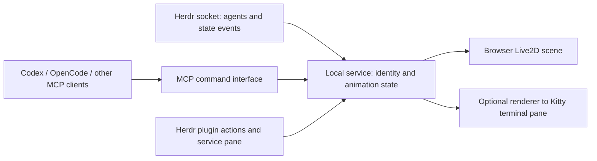

# Herdr + Live2D + MCP feasibility report

Research date: 14 October 2026. Scope: research and proposed design; no plugin installed, configuration changed, or models downloaded.

Confirmed release design: the public repository and releases contain no Live2D character models. Users supply their own permitted runtime model packages and select or change each agent's model from a menu. Model files and local assignments stay outside the source repository.

Subsequent product direction: floating desktop companions inspired by Desktop Mate/Mate Engine. See [the detailed build plan](BUILD_PLAN.md) for repository analysis, the desktop host recommendation, Linux support tiers, and implementation phases. Its desktop-first plan supersedes the browser-first presentation recommendation below; the integration and model research remains applicable.

**The project is technically feasible as a Herdr workflow plugin with a companion renderer and an MCP server.** Herdr already supplies agent discovery and state events. The main constraints are its terminal-based UI, identifying which agent sent a command, differences between models, and Live2D SDK publication licensing. A free project is not automatically exempt from every license requirement.

## 1. What I verified locally

- Installed binary: `/home/mka/.local/bin/herdr`, version **0.9.3**.
- Its bundled API schema reports protocol **22**, schema version **1**.
- The installed schema includes `agent.list`, `session.snapshot`, `events.subscribe`, `pane.agent_status_changed`, and `agent_session_id`. It does not include `pane.graphics.set`.
- Herdr socket files and persisted session data exist under `/home/mka/.config/herdr`.
- Your installed OpenCode integration reports `working`, `blocked`, and `idle` states, plus root agent session identity. It uses `HERDR_PANE_ID` and `HERDR_SOCKET_PATH`, and accounts for child-session events.
- Direct access to the running server returned `Operation not permitted` inside this research sandbox. Therefore I could not verify the current live agent count or exercise event delivery. Socket files alone do not establish server health.

I inspected upstream source at commit `9ee03e36f4e58fa883d5fdc8cb50d127c560e722`, including its versioned **0.9.3** documentation, rather than assuming current development features exist in your installation. The upstream checkout is in `/tmp/herdr-research`.

## 2. Herdr integration capabilities

Herdr plugins are executable packages described by `herdr-plugin.toml`. They can declare actions, event hooks, terminal panes, startup hooks, and link handlers, and call the CLI or socket API. Runtime context includes socket location, pane/workspace IDs, and plugin config/state directories. Native graphical plugin UI is outside plugin v1. Startup hooks are one-shot initialization, not supervised daemons. A persistent service therefore needs an explicit lifecycle, such as a long-running plugin pane process or a separately managed local service. [Herdr plugin documentation, version 0.9.3](https://github.com/herdrdev/herdr/blob/9ee03e36f4e58fa883d5fdc8cb50d127c560e722/docs/versions/0.9.3/website/src/content/docs/plugins.mdx)

| Requested feature | Assessment | Qualification |
| --- | --- | --- |
| One character for each open agent | Feasible | Initially define an agent as a recognized Herdr pane occupant. |
| Automatic working/blocked/idle animation | Feasible | Depends on the accuracy of each agent integration. |
| Agent chooses an expression or motion over MCP | Feasible | Configure the server in each agent client. |
| Native Live2D widget inside Herdr's UI | Unsupported by plugin v1 | Requires upstream UI work or a fork. |
| Live2D images inside a terminal pane | Conditional | Render frames externally and emit Kitty graphics; test terminal compatibility and throughput. |
| Browser or desktop character dashboard | Feasible | Plugin launches a companion renderer. |
| Every agent running anywhere on the machine | Not supplied by Herdr alone | Add adapters for sessions outside Herdr. |
| One avatar for every internal subagent | Not guaranteed | Separate subagent discovery is needed; root-pane state is insufficient. |
| Detailed thinking/testing/success/error states | Additional signals needed | Herdr's broad states do not prove these activities. |

The socket API supports agent listing, snapshots, and lifecycle/state subscriptions. It also documents Kitty graphics output through pane terminals; the old `pane.graphics.*` socket overlay API has been removed. [Herdr socket API, version 0.9.3](https://github.com/herdrdev/herdr/blob/9ee03e36f4e58fa883d5fdc8cb50d127c560e722/docs/versions/0.9.3/website/src/content/docs/socket-api.mdx)

## 3. Recommended architecture



Recommended first stack: **TypeScript/Node local service, official Cubism SDK for Web, and a browser canvas**. The official Web samples provide a starting implementation; Cubism Core is a separate dependency with its own terms. This choice avoids implementing a renderer and animation framework from scratch. [Official Cubism Web samples](https://github.com/Live2D/CubismWebSamples)

The plugin can expose launch, stop, open-view, and status actions, plus a service pane that owns the process. One shared service should serve multiple agents and browser views. Closing a browser view should not disconnect the agent inventory; service shutdown should terminate owned child processes. Persist character assignments in the plugin state directory.

The model menu should offer import, preview, assign to agent, switch, and remove from the local library. Import a complete runtime folder/package rather than a lone `.moc3` file, validate its referenced files and supported runtime version, and discover its motions and expressions. Store user assets in an application data directory outside the checkout; exclude local assets from Git and release packaging. In a browser-only implementation, use a folder picker or package upload; a desktop wrapper can offer a native folder dialog. Load and validate a replacement before swapping it into the scene, then release the previous model's resources. Preserve the current agent state through the switch and use the replacement model's action mappings. With no model installed, show a placeholder and an import button.

Use WebSocket or SSE between the service and browser. Browsers cannot directly connect to Herdr's Unix socket. Start with a normal dashboard; desktop transparency, always-on-top behavior, and click-through can be a later wrapper whose Linux/Wayland behavior needs testing.

For automatic state, subscribe to lifecycle/state events, then reconcile against an authoritative snapshot. On reconnect or `events_lost`, subscribe again and rebuild current state. Herdr documents that snapshots and events have no shared sequence boundary; treat events as invalidations rather than blindly replaying them over a snapshot. [Socket event recovery](https://herdr.dev/docs/socket-api/)

## 4. MCP command design

The agents are **MCP clients**; your extension exposes the **MCP server**. A tool call can deliver a message and request an animation. A polling `get_command` tool is only necessary if agents also need to retrieve queued messages from the extension.

| Proposed tool | Purpose |
| --- | --- |
| `avatar_capabilities` | Return the caller's supported expressions, motions, and semantic actions. |
| `avatar_animate` | Request a named semantic animation, with a bounded duration. |
| `avatar_message` | Show a plain-text speech bubble, optionally with an expression. |
| `avatar_reset` | End a temporary override and return to automatic state. |
| `avatar_status` | Report current state and renderer connection status. |

Example proposed call:

```json
{
  "tool": "avatar_animate",
  "arguments": {
    "action": "celebrate",
    "duration_ms": 3000,
    "message": "Tests passed"
  }
}
```

These are proposed tools, not existing Herdr APIs. Resolve the target from authenticated connection context rather than allowing an agent to choose any pane ID. Return whether the command was accepted, queued, or rejected; do not claim it was displayed unless the renderer acknowledges it.

**Start with per-agent stdio bridges forwarding to one shared service.** Each bridge can capture the launching pane's Herdr environment. A bridge is not a separate UI process. An alternative is one Streamable HTTP endpoint shared by all clients, with explicit per-agent registration and tokens. MCP supports both transports; stdio is client-launched, while Streamable HTTP runs independently and supports multiple connections. Bind local HTTP to loopback, validate Origin, and authenticate connections. [MCP transport specification](https://modelcontextprotocol.io/specification/2025-11-25/basic/transports)

Codex supports stdio and Streamable HTTP MCP servers; its stdio configuration can forward selected environment variables. Forward the pane/socket context explicitly, rather than assuming every variable reaches the subprocess. This requires no OpenAI API key for the local animation server itself. [Codex MCP configuration](https://learn.chatgpt.com/docs/extend/mcp?surface=cli)

OpenCode also supports local and remote MCP servers. Its shared-server/attached-client modes deserve a specific identity test: a shared process may not inherit the attached pane's environment. Use a pane-specific launcher or explicit registration in those cases. [OpenCode MCP documentation](https://opencode.ai/docs/mcp-servers/)

MCP availability does not make an agent send commands automatically. Add concise client instructions, for example to celebrate after successful tests or show a question expression when requesting user input. Automatic broad state animations should continue even when the agent never calls MCP.

## 5. Identity and animation behavior

Use a runtime identity comprising Herdr server/session, pane ID, and occupant generation or agent session ID. A reused pane must not give an old MCP connection control over a new agent's avatar. Bind each connection to its current occupant, validate before applying commands, and invalidate it when that occupant exits or changes. Durable character preferences can use a separate user-selected assignment key.

| Signal | Suggested visual behavior |
| --- | --- |
| Working | Focused idle loop or subtle movement |
| Blocked | Attention expression and visible status marker |
| Idle | Relaxed loop |
| Agent appears | Brief entrance |
| Agent exits | Remove or fade its character |
| Service loses Herdr | Disconnected marker; do not pretend the agent is idle |
| MCP celebration | Temporary motion, then return to current automatic state |

Keep blocked/disconnected indicators visible even during cosmetic overrides. Bound command durations, expire old commands, coalesce bursts, and avoid replaying obsolete celebrations after reconnect.

Each model needs a mapping from semantic actions to its available motion groups, expressions, and parameters. Model files do not share universal `happy` or `typing` animations. Unsupported actions should have a declared fallback or return a clear error.

Runtime packages normally need `.model3.json`, `.moc3`, textures, and any referenced motions, expressions, physics, and pose files. A PSD or editor project alone is not a runnable avatar. Parameter animation can use an existing rig; it cannot create missing artwork, a new arm pose, or a prop absent from that rig. [Official model format](https://github.com/Live2D/CubismSpecs/blob/master/FileFormats/model3.json.md)

## 6. Free model candidates

**Best initial choice: official Live2D originals.** Their pages provide embedding/runtime assets and documented terms, unlike many free downloads that supply only illustration or practice files.

| Model | Why it fits | License/use conclusion |
| --- | --- | --- |
| [Hiyori Momose](https://www.live2d.com/en/learn/sample/momose-hiyori/) | Anime avatar with runtime files, motions, physics, and pose settings | Strong prototype choice. Preserve her character design. |
| [Haru](https://www.live2d.com/en/learn/sample/haru/) | Another official anime character for agent differentiation | Candidate under official-original terms; inspect the downloaded runtime's actual capabilities. |
| [Tororo & Hijiki](https://www.live2d.com/en/learn/sample/tororo-hijiki/) | Cat characters with motions and physics | Good mascot alternative; includes embedding assets. |
| [Simple model](https://www.live2d.com/en/learn/sample/simple-model/) | Minimal integration reference | Useful to establish loading and motion control before a richer character. |
| [Goth Mofu, SadWhale Studios](https://sadwhale-studios.itch.io/goth-mofu) | Free/name-your-price rigged character | Creator allows use and texture editing but prohibits redistribution/resale. User download/import only; verify suitability outside its VTube Studio configuration. |
| [Q版小熊貓2.0, rx_kuma](https://rxkuma.booth.pm/items/6625887) | Free chibi character with four expressions | Conditional lead only: page says the item is private despite exposing listing text. Terms prohibit transferring/reselling files and AI training; custom-renderer permission needs clarification. |

Official originals can be used by qualifying individuals/small enterprises for commercial or noncommercial works under the Free Material Agreement. Attribution and individual character restrictions still apply. Hiyori's design cannot be changed. Collaboration and externally licensed characters have different terms, so avoid treating Hatsune Miku or Unity-chan as interchangeable defaults. Permission to distribute a work does not mean unrestricted permission to mirror raw model archives. [Free Material Agreement](https://www.live2d.com/eula/live2d-free-material-license-agreement_en.html), [sample character terms](https://www.live2d.com/en/learn/sample/model-terms/)

For local prototype testing, **Hiyori and Haru**, or **Tororo/Hijiki**, remain useful optional assets. Users obtain their own models from their creators; none are committed or included in releases. Allow users to record source URL, license, and attribution alongside each local model. Compatibility with the renderer does not itself grant permission to use a character.

## 7. The most consequential release constraint

Model permission and SDK permission are separate. Live2D says its SDK is free for development, while publication depends on the applicable release category. Its usual individual/small-business exemption excludes Expandable Applications. [SDK release licensing](https://www.live2d.com/en/sdk/license/)

An app accepting arbitrary user-supplied avatars is a strong candidate for the **Expandable Application** category, which expressly includes software using indefinite numbers of models through added files. Live2D requires review and a special publication agreement for every such application, including individual publishers. Its page says fully free applications are generally ineligible, with possible exceptions under separately specified conditions. Thus “I will not sell it” does not establish permission to release an unrestricted model-loading application. This project's exact classification remains unconfirmed. [Expandable Application terms](https://www.live2d.com/en/sdk/license/expandable/)

Excluding character models from Git and releases addresses project-side model redistribution. It does not remove this SDK classification question: the published software still loads user-added models. Publishing source code and distributing the Cubism runtime also have distinct license considerations; do not assume excluding character assets settles the runtime's redistribution terms.

Practical options:

1. Develop a private prototype with permitted assets and SDK terms observed.
2. Before public release, ask Live2D whether this agent visualizer is expandable, particularly if it imports arbitrary models.
3. Consider a fixed catalog of licensed characters, and seek confirmation of that design's classification. A fixed catalog is not a guaranteed exemption.
4. Consider an MCP bridge to an existing licensed renderer. VTube Studio exposes model, hotkey, expression, and parameter APIs, but its fit for simultaneous independent agent avatars and your Linux setup needs separate verification. It does not automatically fulfill the multi-avatar requirement. [VTube Studio API](https://github.com/DenchiSoft/VTubeStudio)

No licensing inquiry or message to a creator was sent during this research.

## 8. What to build first, and what still needs testing

Recommended MVP: a Herdr manifest plus owned service pane, a read-only agent inventory adapter, one browser scene, a local model import/selection menu with per-agent assignments, automatic working/blocked/idle behavior, and a stdio MCP bridge exposing capabilities, animation, and messages. Test locally with two separately obtained models; ship none.

Acceptance checks before broadening scope:

- Discover current recognized agents and correctly handle appearance, replacement, and exit.
- Verify real state transitions for both Codex and OpenCode.
- Have two simultaneous agents call MCP and prove neither changes the other's character.
- Reconnect after server loss and recover the correct current state without stale commands.
- Verify root-session versus internal-subagent behavior, including attached OpenCode clients.
- Enumerate actual model motions/expressions and test unsupported-action fallbacks.
- Measure CPU/GPU use with several simultaneous models; set an FPS cap and pause hidden characters. No performance figures were measured in this research.
- Separately test Kitty frame output in your terminal if in-pane models are desired. No smooth-animation or compatibility claim is established yet.
- Verify imports, model switching during animation, missing references, and persistence of per-agent selections.
- Verify Git and release artifacts contain no user model assets.
- Resolve SDK publication classification and runtime redistribution terms before distributing a release.

The Herdr/MCP integration can proceed without a Herdr fork. A companion dashboard is the clearest first implementation. In-pane graphics are a viable experiment, and public distribution with arbitrary model import is the largest unresolved constraint.
