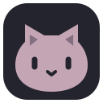
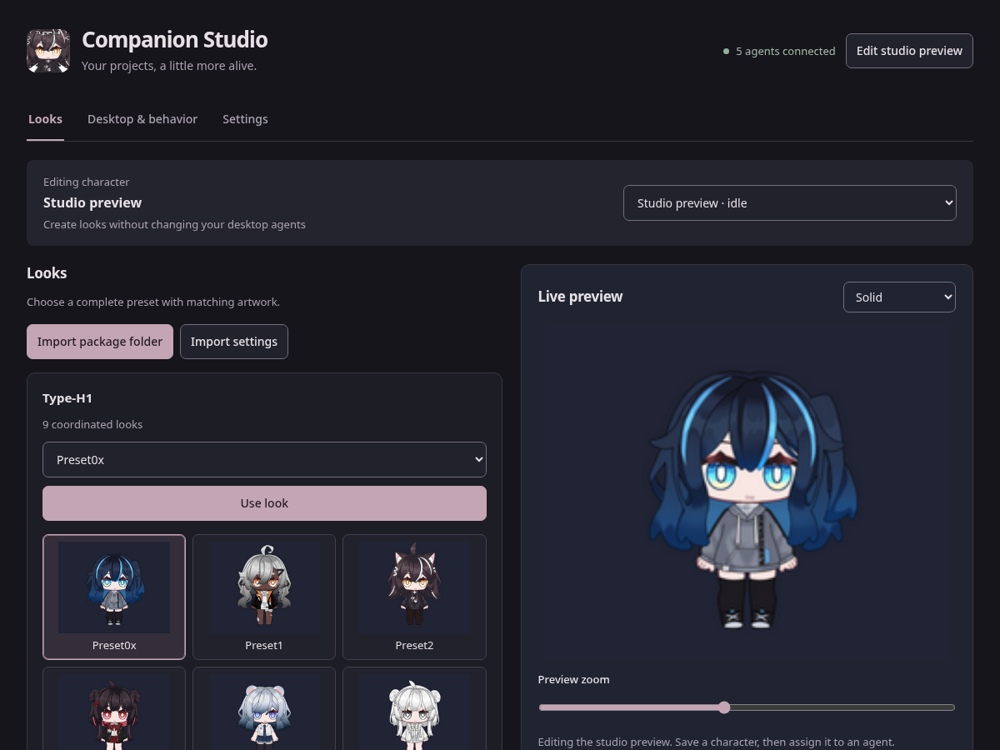
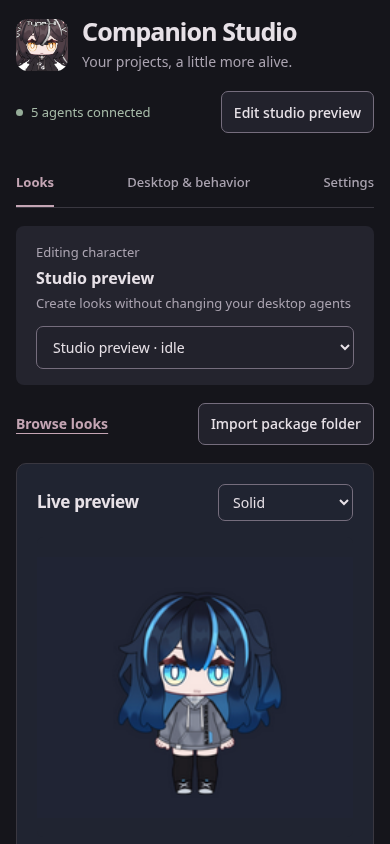
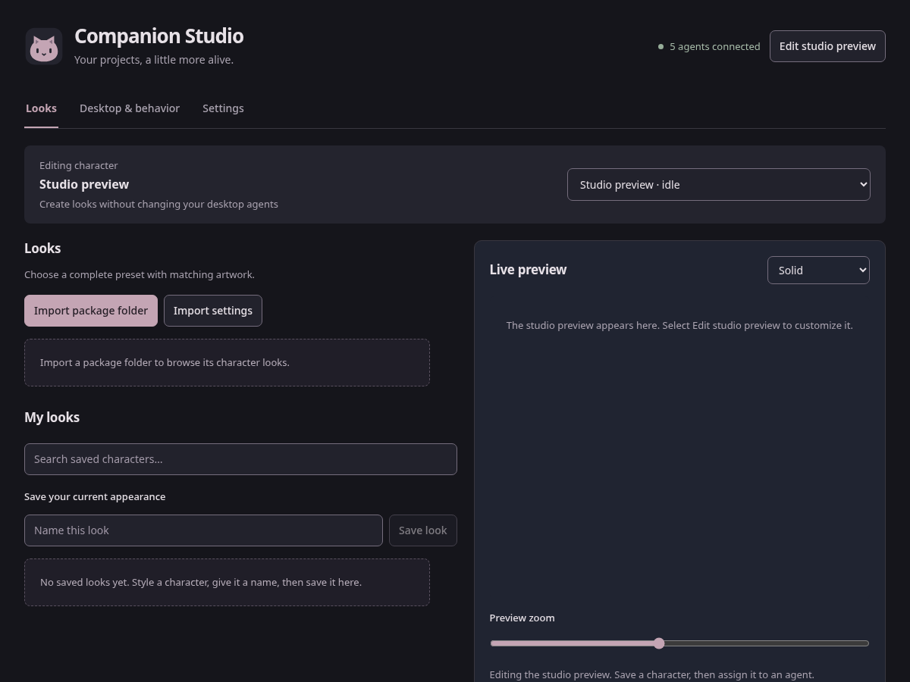
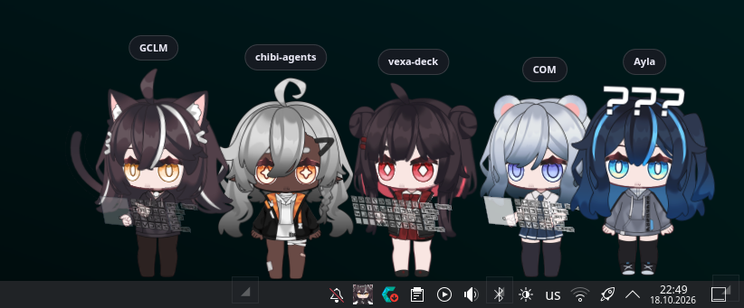
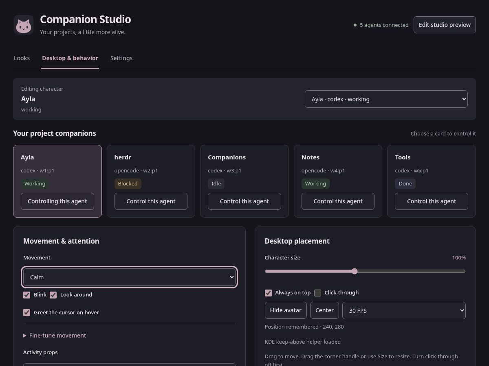
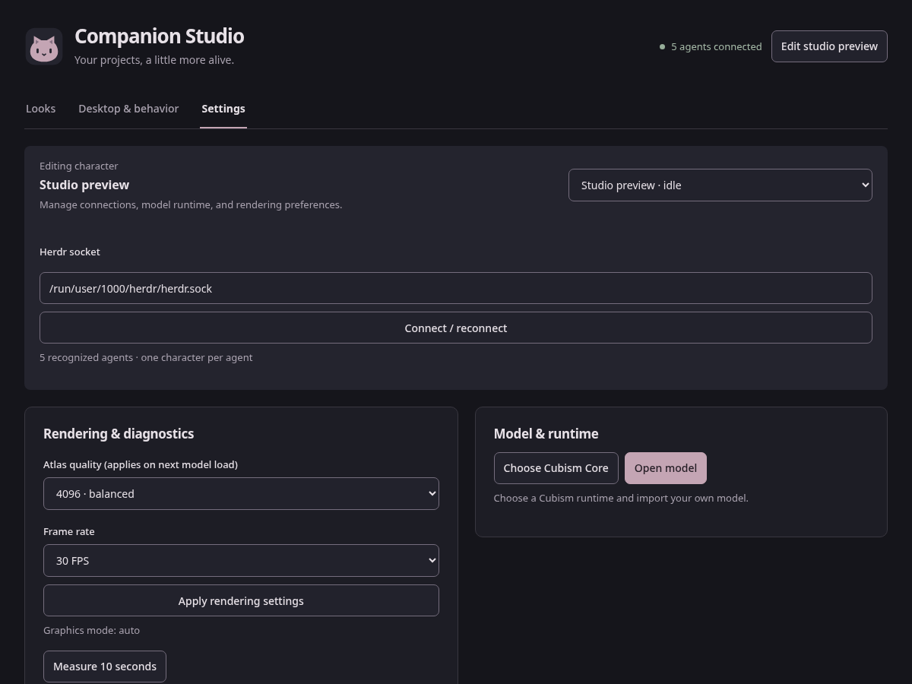

<p align="center">
  
</p>

<h1 align="center">Companion Studio</h1>

<p align="center">Your projects, a little more alive.</p>
<p align="center">Local Live2D desktop companions for coding agents. Bring your own characters.</p>

<p align="center">
  <a href="#installation">Installation</a> ·
  <a href="#first-character">First character</a> ·
  <a href="#example-usage">Example usage</a> ·
  <a href="#herdr-and-mcp">Herdr &amp; MCP</a>
</p>



*Live2D model by [0x4682B4](https://0x4682b4.com/) — [Customizable Chibi Model Type-H1](https://0x4682b4.booth.pm/items/4991289). Character artwork is shown in a GUI screenshot; model files are not included.*

**This repository contains the application system only.** Live2D models, character artwork, textures, and Cubism Core are not included. Screenshots use illustrative project data. The example gallery, narrow preview, and desktop screenshot show the separately supplied Type-H1 model credited above; installation and settings screenshots show the model-free interface.

<details>
<summary>See the character preview in a narrow window</summary>



Live2D model by [0x4682B4](https://0x4682b4.com/). The artwork belongs to its creator; it is not an application asset licensed for reuse.

</details>

## What it does

- Give each recognized Herdr root agent its own desktop companion, labeled with its project name.
- Import compatible Live2D packages, preview looks, and save characters for reuse.
- Assign different looks to different projects, with independent movement and reaction settings.
- Follow working, blocked, completed, and disconnected states; trigger supported reactions through MCP.
- Adjust size, position, frame rate, always-on-top, and click-through behavior.
- Keep character files and settings local. Imports preserve the original model package.

The dark interface uses matte charcoal surfaces and muted rose accents. Detailed controls stay under disclosures, so browsing and assigning looks remain straightforward.

## Installation

### Requirements

- **Node.js 22.12 or newer**, with npm.
- A graphical desktop capable of running Electron and WebGL.
- Your own compatible Live2D runtime model and a trusted **Cubism Core for Web** runtime.
- **Herdr**, optionally, for automatic project companions and agent-scoped MCP commands.

Desktop validation has focused on Linux with KDE/Wayland and NVIDIA graphics. Other desktops and operating systems have not been fully validated. On KDE, enhanced placement and pointer tracking also use `python3`, `dbus-python`, PyGObject, and `qdbus6`; those packages come from your distribution.

### Install and run

```sh
git clone https://github.com/mkaydin/chibi-agents.git
cd chibi-agents
npm install
npm start
```

No separate installer script is needed. `npm install` installs the JavaScript dependencies and Electron; `npm start` launches the desktop app. The launcher detects Wayland and remembers your selected runtime and model.

**Linux currently defaults to NVIDIA rendering.** On Intel, AMD, or another graphics setup, use:

```sh
npm start -- --graphics auto
```

To use the studio without connecting Herdr:

```sh
npm start -- --no-herdr --graphics auto
```

### Supply Cubism Core

Download the SDK from the [official Cubism SDK for Web page](https://www.live2d.com/en/sdk/download/web/) and follow Live2D's applicable terms. Select its `live2dcubismcore.min.js` file through **Settings → Model & runtime → Choose Cubism Core**. Only select a trusted runtime: this file executes in the character renderer.

You can also select it at launch:

```sh
npm start -- --core /absolute/path/to/live2dcubismcore.min.js
```

The selection is saved locally, so later launches only need `npm start`.

## First character



1. Open **Settings** and choose Cubism Core if you have not already done so.
2. Open **Looks → Import package folder** and select your extracted Live2D package. Keep its manifest, model binary, textures, and referenced files together.
3. Click **Edit studio preview** to work separately from desktop agents.
4. If the package provides appearance presets, select one and click **Use look**. Use **Quick style** or **Advanced customization** for the controls your model exposes.
5. Enter a name under **My looks**, then click **Save look**.
6. Open **Desktop & behavior**, choose a project companion, and use **Change saved look → Assign character**.

For an individual model rather than a package, use **Settings → Model & runtime → Open model** and select its `.model3.json` manifest.

### Model compatibility

The system is not tied to one character. It accepts compatible Cubism runtime exports using a `.model3.json` manifest, a referenced `.moc3` binary, and textures. Cubism 2 `.model.json` exports are not supported by the current importer.

Appearance editing, expressions, motions, accessories, and activity props depend on the model's rig and supplied files. A model does not need to support every reaction. Missing props fall back to standing; unsupported expression operations are identified rather than invented. Texture artwork must match the selected appearance preset. Motion audio is currently muted.

## Example usage

### A companion for each project



*Live2D model by [0x4682B4](https://0x4682b4.com/) — [Customizable Chibi Model Type-H1](https://0x4682b4.booth.pm/items/4991289). User-provided desktop screenshot; model files are not included.*

Start Herdr with a few recognized root agents, then run `npm start`. Each detected root agent gets its own companion; internal subagents are not represented separately.

For example, give a frontend project a calm companion and a test project a livelier one:

1. In **Desktop & behavior**, click **Control this agent** on the frontend project card.
2. Choose **Movement → Calm**, adjust **Character size**, and drag the desktop character into position.
3. Select the test project, assign a different saved look, and choose **Lively**.
4. Enable **Follow agent state** and use **Try a reaction** to preview supported gestures.



Positions and preferences are remembered per agent. Titles above desktop characters show only their project names. Turn click-through off before dragging or resizing; the tray provides a way back to the controls.

### Edit a look without changing agents

Use **Edit studio preview**, adjust the appearance, and save a named look. Assign that look explicitly when you want an agent to use it; editing a saved character does not silently replace running agents.

- **Undo / redo:** Ctrl/Cmd+Z and Ctrl/Cmd+Shift+Z, or Ctrl/Cmd+Y, outside text fields.
- **Save workspace:** preserve the studio baseline without overwriting a named character.
- **Revert saved:** restore the saved workspace appearance.
- **Recovered draft:** restore or discard unsaved studio edits after a restart.
- **Package options:** generate preset thumbnails, refresh changed files, or relink a moved package.

### Tune rendering

Open **Settings → Rendering & diagnostics** to select atlas quality and frame rate. Quality takes effect on the next model load. Start with 4096 atlases and 30 FPS, then adjust for your models and number of companions. **Measure 10 seconds** writes a local performance report under `artifacts/`.



Each companion has its own renderer, so additional characters increase GPU and memory use. Software rendering caps atlas size at 2048.

## Herdr and MCP

The app connects to the default Herdr socket, or to the path chosen in **Settings**. A custom socket can also be supplied at launch:

```sh
npm start -- --herdr-socket /absolute/path/to/herdr.sock
```

An optional plugin is included:

```sh
herdr plugin link "$PWD/integrations/herdr"
herdr plugin action invoke ayla.companions.launch
```

The stdio MCP bridge is `scripts/mcp-bridge.mjs`. It exposes `avatar_capabilities`, `avatar_status`, `avatar_animate`, `avatar_message`, and `avatar_reset`. Commands are authenticated and scoped to the current recognized agent session. The bridge needs that agent's `HERDR_PANE_ID` and `HERDR_SOCKET_PATH`; do not reuse another pane's values.

See [Herdr and MCP setup](integrations/SETUP.md) for client configuration and activity hooks. MCP configuration keys retain the historical `ayla` name for compatibility.

## Launch options

Pass options after `npm start --`:

| Option | Purpose |
| --- | --- |
| `--graphics auto` | Let Electron choose the graphics backend. |
| `--graphics nvidia` | Request NVIDIA PRIME offload on Linux; the current Linux default. |
| `--graphics opengl` | Request ANGLE with the OpenGL backend. |
| `--graphics software` | Use software rendering as a fallback. |
| `--x11` | Use X11 instead of automatically detected Wayland. |
| `--native-wayland` | Explicitly request native Wayland. |
| `--core /path/to/runtime.js` | Select a trusted Cubism runtime. |
| `--model /path/to/character.model3.json` | Select a startup model. |
| `--no-herdr` | Run without automatic Herdr connection. |
| `--desktop-preview` | Use a separate desktop studio preview window. |

Wayland always-on-top, placement, and click-through depend on the compositor and Electron version. The launcher can select a compatible installed Electron runtime on Linux. `COMPANION_ELECTRON_BIN` overrides that selection.

## Local files and sharing

Keep complete downloaded character packages under `live2d-assets/` or `.local/`. Both directories are ignored by Git, including their artwork, thumbnails, and licenses. Model binaries, common model metadata, atlas folders, asset archives, and Cubism runtime files are also ignored.

```text
chibi-agents/
├── electron/        Desktop windows, IPC, and avatar sessions
├── lib/             Model import, settings, behavior, and integrations
├── web/             Studio interface and character renderer
├── integrations/    Optional Herdr plugin and MCP setup
├── scripts/         Launch, diagnostics, and source packaging
├── tests/           Automated checks
├── docs/            Documentation icon and attributed GUI screenshots
├── live2d-assets/    Your local model packages — ignored
└── .local/          Your local runtime and development assets — ignored
```

Settings use Electron's local `ayla-companions` user-data directory for compatibility; `COMPANION_DATA_DIR` overrides it. On Linux this is normally `~/.config/ayla-companions/`. Generated texture variants and recovery backups stay local. Character-settings exports contain local model references and appearance values, not the model files themselves.

Ordinary images outside ignored model directories can still be versioned for application UI and documentation. Check `git status` before publishing; keep complete private packages in the ignored directories.

## Model artist credit

**Live2D model by [0x4682B4](https://0x4682b4.com/).** The example characters shown in the gallery and preview screenshots are customized appearances of **Customizable Chibi Model Type-H1 (v2.0)**.

- [Artist's product page](https://0x4682b4.booth.pm/items/4991289)
- [Model documentation](https://0xlive2dmodels.glycoproduction.com/models/type-h1/)
- [Artist's license](https://0xlive2dmodels.glycoproduction.com/license/)

The artist retains ownership of the model and artwork. No affiliation or endorsement is implied. The application source does not include or grant rights to the model, its textures, or Cubism Core. Obtain your own model license from the artist.

The app imports the supplied Live2D model and plays its authored animations and expressions locally. Coding-agent status signals select reactions; the model assets are not used for AI training or edited with generative AI. The screenshots demonstrate that rendering and playback. Use of the model and its artwork remains subject to the artist’s license.

## Development and source packaging

```sh
npm test                  # Automated tests
npm run check             # Tests and JavaScript syntax checks
npm run package:source    # Build a source-only folder under dist/
```

The source builder uses an allowlist and writes `dist/companion-studio-source`. It excludes model packages, Cubism Core, dependencies, local settings, and diagnostics. It does not publish anything. This is a source export, not a standalone installer; recipients run `npm install` and supply their own assets.

To reproduce the documentation screenshots without loading any models:

```sh
node scripts/ui-preview.mjs --docs
```

Open the local URL printed by that command. This is an isolated UI fixture with illustrative agent data; its actions do not control real companions.

## Troubleshooting

- **Blank character:** select a trusted Cubism Core runtime, then import a compatible model with all referenced files present.
- **NVIDIA error on another GPU:** launch with `npm start -- --graphics auto`.
- **Cannot move the character:** turn click-through off first.
- **No project companions:** check Herdr's socket path and connection in Settings; the studio can run independently.
- **Missing animation or accessory:** check whether the imported model supplies it. Controls and reactions are capability-dependent.
- **Model folder moved:** use the package's **Relink folder** or a saved character's **Relink model file** action.

Startup diagnostics are written to `artifacts/startup.log`. See [integration setup](integrations/SETUP.md) for agent configuration.
